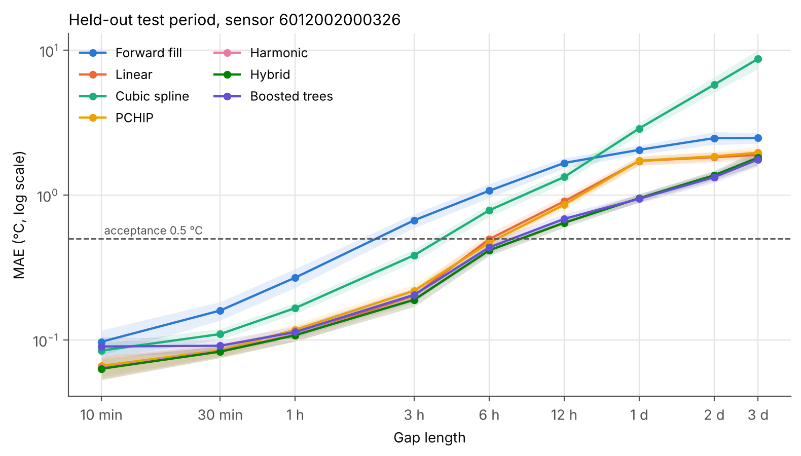
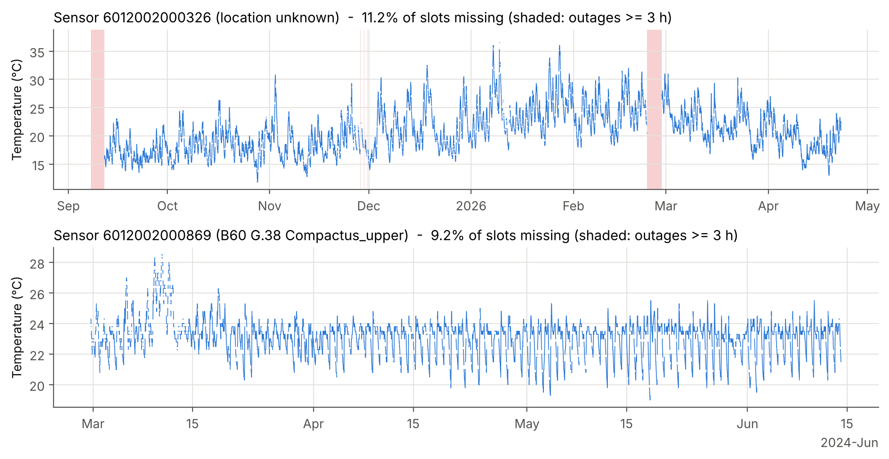
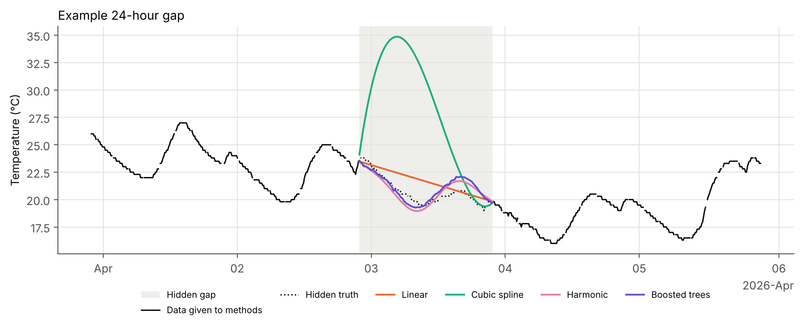

# Reconstruction of Missing Indoor Temperature Readings

MMA3001 Numerical Methods and Machine Learning - individual project.
Dataset 2: Monash Smart Infrastructure environmental sensor data.

This repository fills gaps in 10-minute indoor temperature records from NEMo
environmental sensors, and quantifies how accurate the filled values are as a
function of gap length. It compares classical numerical interpolation, a
Fourier least-squares model and a gradient-boosted machine-learning model,
validated on artificial gaps with known ground truth.



---

## 1. Engineering problem

**Context.** Monash Buildings 60 and 69 carry environmental sensors that
report temperature, humidity, CO2 and particulates every 10 minutes. These
records feed thermal-comfort assessment, HVAC scheduling and fault
detection, and energy analysis.

**Problem.** Readings go missing. For the main sensor about 11% of
10-minute slots are empty: mostly single dropped uploads, plus occasional
multi-day outages. Most downstream analyses need a continuous series, and
naive filling (holding the last value, or joining the dots) can bias
comfort statistics, for example by hiding an afternoon overheating peak.

**Intended use.** Produce a gap-free series where every filled value is
flagged and carries a validated expected error, so an engineer can decide
whether a reconstructed period is good enough for their analysis.

**Scope and limitations of scope.**
* Temperature only, one sensor at a time (no spatial interpolation). The
  two usable sensors never overlap in time, so neighbouring-room
  information cannot be used with this extract.
* Gaps from 10 minutes to 3 days are validated. Longer gaps are filled but
  their error is not validated (flagged `NaN` in `expected_abs_error`).
* Outages longer than 7 days split a record. Only the longest active span
  is reconstructed.
* No external data (e.g. outdoor weather) is used.

## 2. Inputs and outputs

### Inputs

| Input | Format | Units / domain | Handling of invalid data |
|---|---|---|---|
| `data/5EnvSensor_MayToDec2024_180kRows.zip` | ZIP containing one CSV with columns `sensorid` (string) and `jsondata` (JSON list of `{variable, values}` objects) | Temperature in °C (variable `"Temperature"`, unit `"°C"`); time as Unix seconds (UTC) | Malformed JSON, missing IDs, non-numeric values and invalid times are counted and dropped; other units are ignored; duplicate uploads are averaged (conflicts counted); values outside 10-40 °C are flagged `suspect` (none occur) |
| `data/Sensor ID and Locations.xlsx` (optional) | Workbook, sheet `ENV` | Building, room, area per sensor ID | If missing, locations show as unknown |

The dataset belongs to Monash University and is **not** included in this
repository. Download it from the unit's Moodle page and place both files in
`data/` with the names above.

### Outputs (in `results/`)

| Output | Meaning and intended use |
|---|---|
| `reconstructed_<sensor>.csv` | Continuous 10-minute series: `time` (Australia/Melbourne), `temperature` (°C, measured or filled), `reconstructed` (bool), `gap_len_slots` (length of the gap the slot belongs to, 0 if measured), `expected_abs_error` (validated MAE for that gap length, °C; 0 if measured; NaN beyond 3 days) |
| `RESULTS.md` | Auto-generated summary of all headline numbers |
| `selected_settings.json` | Tuned settings and the selected method |
| `tables/*.csv` | Every experiment's raw results |
| `figures/*.png` | Report figures |
| `test_report.html` | pytest report |

Function-level inputs and outputs are documented in docstrings and in the
HTML documentation (`docs/index.html`).

## 3. Data audit - what the extract actually contains

| Finding | Consequence |
|---|---|
| Only 2 of the 5 sensors have usable data (`...0326`: 29,038 readings; `...0869`: 13,800); the other three have 1-2 readings each | Primary sensor `...0326` (Sep 2025 to Apr 2026, location not in the location table); secondary `...0869` (B60 G.38 Compactus upper, Feb-Jun 2024) |
| 76% of CSV rows are exact duplicates (zero conflicting values) | Deduplicated by timestamp |
| The file name says "May to Dec 2024", but measurement times span 2023-2026 | Measurement time taken from `jsondata`, not `createdate` |
| Sensor clocks drift: the offset from the 10-minute mark wanders through the whole 10 minutes | Readings are placed on the grid by rounding each *interval* to whole steps, not by clock time (0 collisions, max rounding error 77 s) |
| About 95% of gaps are a single missed reading; the primary sensor has two outages of 4.1 and 4.5 days | No stretch longer than about 5 hours is fully observed, which shapes the validation design (Section 5) |



## 4. Computational methods

All methods take the regular 10-minute series and fill every missing slot.
Observed values are never changed.

| Method | How it works | Why included | Key assumption / limitation |
|---|---|---|---|
| Forward fill | Repeat last reading | Baseline: what many dashboards do | Temperature constant during gap |
| Linear | Straight line between the readings either side (`numpy.interp`) | Baseline; O(h^2) accurate for smooth signals | No daily cycle inside the gap |
| Cubic spline | Global C2 spline through all readings (one banded solve) | Classical high-order interpolant, O(h^4) | Overshoots badly on long gaps |
| PCHIP | Piecewise cubic Hermite, Fritsch-Carlson slopes | Shape-preserving alternative, no overshoot | No daily cycle inside the gap |
| Harmonic | Local least-squares fit of constant + trend + K daily + J weekly Fourier terms over ±7 days; the residual at the gap edges is bridged linearly | Supplies the daily/weekly *shape* the interpolants cannot; edge bridging fixes the level | Assumes the occupancy-driven cycle repeats |
| Hybrid | Linear for gaps ≤ 6 slots (1 h), harmonic above | Same accuracy as harmonic, far cheaper | Switch length tuned on validation data |
| Boosted trees | `HistGradientBoostingRegressor` learns a correction to the harmonic fill from gap context (length, position, time of day, weekend, edge values, slopes) | Machine-learning alternative that can learn patterns the Fourier model misses | Needs training data from the same sensor |

Settings tuned on the validation period: **K = 2** daily harmonics,
**J = 2** weekly harmonics, **7-day** window, hybrid switch at **6 slots**.

## 5. Validation design

Real gaps have no ground truth, so methods are scored on **artificial gaps**
cut out of observed data, where the removed readings are known.

```
|---------- train ----------|-- validation --|------- test -------|
0%                         55%              70%                 100%
 boosted model fitted here   tuning + method   reported results
                             selection          only
```

* **Chronological three-way split** of the primary sensor. Tuning and
  method selection use only the validation period. The test period is used
  once, for the reported numbers, so it did not influence any choice.
* **Gap lengths** 10 min, 30 min, 1 h, 3 h, 6 h, 12 h, 1 day, 2 days and
  3 days. 20 gaps per length per repeat, 10 repeats. Gaps never overlap.
* **Anchors observed:** the slot before and after each gap holds a real
  reading, so every gap has exactly the stated length.
* **Partially observed gaps:** at least 80% of a gap's slots must hold
  real readings; errors are scored only where the truth is known. Requiring
  100% would make gaps over about 5 hours untestable on this data.
* **Metrics:** MAE (primary), RMSE, maximum absolute error and bias, with
  95% bootstrap confidence intervals resampling whole gaps (points inside a
  gap are correlated).
* **Acceptance criterion:** MAE ≤ 0.5 °C. *This is an assumed figure based
  on typical indoor sensor accuracy and should be checked against the NEMo
  sensor datasheet.*
* **Generalisation:** the secondary sensor (a different room, two years
  earlier) is never used for fitting or tuning.
* **Verification of implementation** (unit tests): exact reproduction of
  linear and cubic functions, exact recovery of a known Fourier signal,
  and measured **convergence orders of 2.0 (linear) and 4.0 (cubic
  spline)**, matching theory.

**What this validation cannot establish:** whether real outages behave
like random artificial gaps (real outages may cluster with events such as
power cuts that also change temperature); accuracy beyond 3 days;
performance in other rooms, seasons or HVAC regimes not covered by the two
sensors.

## 6. Results

### Held-out test MAE (°C), primary sensor

| Gap | Fwd fill | Linear | Spline | PCHIP | Harmonic | **Hybrid** | Boosted |
|---|---|---|---|---|---|---|---|
| 10 min | 0.097 | **0.063** | 0.084 | 0.066 | 0.064 | **0.063** | 0.090 |
| 1 h | 0.269 | **0.108** | 0.166 | 0.117 | 0.109 | **0.108** | 0.113 |
| 6 h | 1.070 | 0.495 | 0.784 | 0.469 | **0.415** | **0.415** | 0.434 |
| 12 h | 1.664 | 0.904 | 1.331 | 0.859 | **0.643** | **0.643** | 0.684 |
| 1 day | 2.051 | 1.720 | 2.880 | 1.724 | 0.951 | 0.951 | **0.942** |
| 3 days | 2.474 | 1.893 | 8.713 | 1.960 | 1.812 | 1.812 | **1.759** |

Full tables for all nine gap lengths: `results/RESULTS.md`.

**Findings**

1. **Short gaps (≤ 1 h): linear interpolation is as good as anything.**
   Errors are close to the sensor's 0.1 °C resolution, and the spline and
   boosted model are slightly *worse* (they add structure that is not there).
2. **Long gaps (3 h to 2 days): the harmonic model roughly halves the
   error of interpolation** (1 day: 0.95 vs 1.72 °C), because only it knows
   the building's daily cycle.
3. **The cubic spline is the worst method for long gaps** (8.7 °C at 3
   days; in the example below it swings up to 35 °C when the truth stays near 20 °C): the classic consequence of
   an unconstrained global polynomial between distant knots.
4. **Boosted trees are best only at 1-3 day gaps, by 1-3%**, well within
   the 95% confidence intervals (1 day: 0.94 [0.88, 1.01] vs hybrid 0.95
   [0.89, 1.01] °C), at about 50x the fill cost of the hybrid plus a 31 s
   training step. On the unseen secondary sensor they are clearly worse
   than the hybrid (1 day: 0.70 vs 0.58 °C), so the extra complexity is not
   justified.
5. **Selected method: hybrid.** It is the fastest method within 2% of the
   best validation MAE. It meets the 0.5 °C acceptance up to **6-hour**
   gaps on the test period (and up to 12 h on the secondary sensor). For
   longer gaps the reconstruction is useful for daily patterns but not for
   precise comfort assessment.
6. **Results generalise.** On the secondary sensor the ranking is the same
   and the hybrid's errors are lower (that room is more stable).
7. **Error depends on when a gap occurs.** 6-hour gaps starting overnight
   are filled to about 0.2 °C; gaps over the morning warm-up or the
   afternoon peak are 2-3x worse (figure 07).



### Sensitivity

* **Daily harmonics K:** K = 0 (no daily cycle) doubles the 1-day error
  (1.93 vs 0.93 °C); K = 1 captures most of the benefit; K ≥ 2 is flat
  (mean MAE 0.973-0.978), so the simplest best value, K = 2, was kept
  (figure 05).
* **Weekly harmonics J:** makes almost no difference for gaps up to 1 day;
  J = 2 was chosen mainly because of the 3-day gaps, which are few and
  noisy (J = 3 is worse there), so this choice is weakly supported.
* **Window half-width:** errors for 3-day gaps fall sharply up to 7 days
  (3.4 °C at 2 days vs 1.6 °C at 7 days), because a short window loses most
  of its data to the gap itself; beyond 7 days results are flat within
  noise. 1-day gaps are insensitive above 3 days (figure 06).
* **Hybrid switch:** harmonic and linear are equivalent up to 1-hour gaps,
  so switching at 6 slots costs no accuracy.

## 7. Performance and optimisation

Filling all 3,669 real gaps of the primary sensor (times vary by about
±30% between runs; two full runs shown as ranges, exact values in
`results/RESULTS.md`):

| Method | Time | Peak memory | Estimated flops | Achieved rate | Fits |
|---|---|---|---|---|---|
| Linear | 0.5-1.0 ms | 1.6 MB | 1.8e4 | 18-41 MFLOP/s | 0 |
| Cubic spline | 2.6-2.7 ms | 5.2 MB | 2.7e5 | ~100 MFLOP/s | 0 |
| PCHIP | 2.0-2.3 ms | 4.1 MB | 6.2e5 | 270-300 MFLOP/s | 0 |
| Harmonic | 840 ms | 6.6 MB | 9.8e8 | 1.2 GFLOP/s | 2,143 |
| **Hybrid** | **18-24 ms** | 6.6 MB | 1.4e7 | 0.6-0.8 GFLOP/s | 15 |
| Boosted trees | 920 ms (+31 s training) | - | - | - | - |

* **Main optimisation: hybrid vs harmonic, 35-45x faster with
  identical accuracy.** Profiling (`results/profile_harmonic.txt`) shows the harmonic
  method's time is spent in 2,143 small least-squares solves, almost all
  for single missed readings where linear is already optimal. The hybrid
  skips them.
* **Arithmetic intensity.** Each harmonic fit is an m x p problem with
  m ≈ 2,000 and p = 10: about 2mp^2 flops on 8mp bytes, roughly p/4 ≈ 2.5
  flops/byte. The data fits in cache, and the achieved rate (about 1
  GFLOP/s) is far below the CPU's peak because Python call overhead per
  small solve dominates, not arithmetic. The cheap interpolants achieve
  only 18-300 MFLOP/s for the same reason: they do so little arithmetic
  that memory traffic and call overhead set the time.
* **Scaling.** All methods scale as O(n): measured log-log slopes 1.02-1.08
  up to 1 million slots (figure 09).
* **Vectorisation.** `numpy.interp` vs an equivalent pure-Python loop on
  1 million slots: 6x faster with identical output.
* **Numerical stability.** With an uncentred trend column the design
  matrix has condition number 1.6e4 and the normal equations 2.5e8,
  giving 2e-11 coefficient error versus the SVD solution. Centring the
  trend cuts the condition number to 4.9 (normal equations 24) and the
  error to 2e-13. The code centres the trend and uses the SVD-based
  `lstsq`; normal equations would be 5x faster per solve but square the
  condition number.

## 8. Limitations and lessons learned

* Long-gap accuracy is limited by **day-to-day variability** the model
  cannot know about (weather, occupancy changes). Outdoor temperature data
  (e.g. Bureau of Meteorology, Melbourne) would be the most valuable extra
  input, for example in a lumped-capacitance (RC) thermal model.
* The **primary sensor's room is unknown**: it is absent from the location
  table, so its behaviour cannot be linked to a room type.
* The **acceptance threshold is assumed**, not taken from the datasheet.
* Only **two sensors**: claims about other rooms are unsupported.
* Lesson: the most complex method (boosted trees) did not earn its cost.
  Physical structure (a daily cycle) built into a simple least-squares model
  generalised better than learning it from data.
* Lesson: validation design had to change after meeting the real data
  (partially observed gaps), and averaging metrics across gap lengths hid a
  real loss when tuning the hybrid switch.

## 9. Repository structure

```
MMA3001-Temperature-Reconstruction/
├── main.py                 command-line entry point (all stages)
├── tempfill/               the Python package
│   ├── data.py             loading, deduplication, 10-minute grid
│   ├── methods.py          gap-filling methods
│   ├── validation.py       synthetic gaps, metrics, bootstrap CIs
│   ├── performance.py      timing, memory, scaling, solver stability, flops
│   ├── experiments.py      the experimental protocol (split, tuning, ...)
│   └── plots.py            report figures
├── tests/                  pytest suite (48 tests)
├── docs/                   HTML documentation (pdoc)
├── results/                generated tables, figures, RESULTS.md, test report
├── data/                   put the dataset here (not committed)
├── requirements.txt
├── AI_USE.md               log of AI assistance
└── LICENSE                 MIT (code only)
```

## 10. Setup and usage

Requires Python 3.10 or newer.

```bash
python -m venv .venv
# Windows (Command Prompt):  .venv\Scripts\activate
# Windows (PowerShell):      .venv\Scripts\Activate.ps1
#   if PowerShell blocks scripts, run once:
#   Set-ExecutionPolicy -Scope CurrentUser RemoteSigned
# macOS / Linux:             source .venv/bin/activate
pip install -r requirements.txt
```

Place the dataset in `data/` (see Section 2), then:

```bash
python main.py              # everything, about 8 minutes
python main.py --quick      # smoke run with fewer repeats, about 3 minutes
python main.py audit        # one stage: audit | tune | validate | performance | reconstruct
```

All randomness is seeded (`Config.seed = 2026`), so results reproduce exactly.

### Tests

```bash
pytest                                                       # 48 tests, a few seconds
pytest --html=results/test_report.html --self-contained-html  # HTML report
```

### Documentation

```bash
pdoc tempfill -o docs --docformat google
```

Open `docs/index.html`. Docstrings follow the Google style.

## 11. AI use

Claude (Anthropic) was used substantially in this project. See
[`AI_USE.md`](AI_USE.md) for what it produced and the issues found while
checking its output. The reflection on AI use is in the written report.

## 12. References

* Fritsch, F. N. & Carlson, R. E. (1980). Monotone piecewise cubic
  interpolation. *SIAM Journal on Numerical Analysis*, 17(2), 238-246.
* de Boor, C. (2001). *A Practical Guide to Splines* (rev. ed.). Springer.
* Golub, G. H. & Van Loan, C. F. (2013). *Matrix Computations* (4th ed.).
  Johns Hopkins University Press. (Least squares, conditioning, flop counts.)
* Ke, G. et al. (2017). LightGBM: A highly efficient gradient boosting
  decision tree. *NeurIPS*. (Histogram gradient boosting, as implemented in
  scikit-learn.)
* Efron, B. & Tibshirani, R. J. (1993). *An Introduction to the Bootstrap*.
  Chapman & Hall.
* ASHRAE Standard 55 (2023). *Thermal Environmental Conditions for Human
  Occupancy*.
* Monash Smart Infrastructure, NEMo environmental sensor export, provided
  for MMA3001 (2026).

## Licence

Code: MIT (see `LICENSE`). Data: Monash University, not redistributed.
